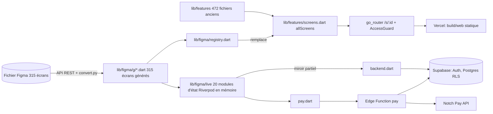

# 01 — Architecture réelle

Constats établis par lecture du dépôt (branche `feat/figma-fidele`, 66 commits, arbre de travail propre au début de l'audit) et mesures sur le site déployé.

## Technologies (VÉRIFIÉ)
- **Application** : Flutter (SDK ^3.13.7, Dart), état avec Riverpod 3, navigation go_router 18, rendu web CanvasKit. Cibles prévues : web, Android, iOS (une seule base de code). Seul le web est construit et déployé ; Android et iOS n'ont jamais été compilés ni testés.
- **Backend** : Supabase (PostgreSQL + Auth + Edge Functions), projet `boutik-ecole`. Une fonction : `pay` (Deno/TypeScript).
- **Paiement** : Notch Pay (Orange Money, MTN MoMo) appelé par la fonction `pay`.
- **Hébergement** : Vercel, dossier `build/web` publié tel quel (`web/vercel.json` : réécriture vers `index.html`, en-têtes de sécurité).
- **Dépendances notables** : supabase_flutter, audioplayers, record, speech_to_text, image_picker, file_picker, pdf + printing (reçu/facture), share_plus, url_launcher, shared_preferences, qr.

## Schéma

## Modules et responsabilités
| Module | Rôle | Persistance |
|---|---|---|
| `tool/figma_export/*` | génère le code des écrans depuis Figma (positions absolues, liens, rôles de composants) ; `bindings.json` ajoute les données et actions | — |
| `lib/figma/g/` | 315 écrans générés (ne pas éditer à la main) | — |
| `lib/figma/gen.dart` | composants : cadre d'écran, champs, interrupteurs, choix, toasts, dialogues, animations | — |
| `lib/figma/live/store.dart` | catalogue, panier, commandes, recherche, favoris | mémoire (commandes miroir Supabase) |
| `auth.dart`, `access.dart` | comptes, validation, rôles, garde d'accès | mémoire + `shared_preferences` (e-mail mémorisé) |
| `seller.dart`, `review.dart` | annonces, stocks, commandes reçues, validation | mémoire |
| `admin.dart`, `audit.dart`, `ops.dart` | comptes/rôles, journal, signalements, commissions, supervision | mémoire (journal miroir Supabase) |
| `talents.dart`, `hackathons.dart`, `missions.dart` | talents/projets, concours, missions et borne | mémoire |
| `chat.dart`, `kela.dart` | messagerie et assistante vocale | mémoire |
| `pay.dart`, `docs.dart`, `share.dart` | paiement Mobile Money, reçu/facture PDF, partage | serveur (paiement) / local |
| `backend.dart` | client Supabase (connexion, profil, commandes, audit) | Supabase |
| `lib/features` | ancienne couche (Copilot), masquée par les écrans générés | — |
| `supabase/schema.sql`, `functions/pay` | schéma de 9 tables avec RLS, fonction de paiement | Supabase |

## Flux de données
Les écrans lisent des providers Riverpod en mémoire. Seuls quatre flux sortent vers Supabase : connexion/inscription, création de commande (+ lignes), journal d'audit, paiement (fonction `pay`). Aucun flux ne **lit** la base pour alimenter un écran (sauf la session d'authentification).

## Points de fragilité
1. Source de vérité = mémoire du navigateur (AN-007).
2. Code des écrans généré : toute régénération écrase les modifications manuelles ; les personnalisations passent par `bindings.json` (remplacements de texte fragiles).
3. Deux couches de code (AN-027).
4. Droits déduits du numéro d'écran (AN-013).
5. Poids du bundle (AN-018).

## Éléments dont l'implémentation réelle reste à prouver
Paiement réel, inscription réelle avec confirmation, envoi de messages vocaux sur appareil, transcription vocale sur mobile, build Android/iOS, notifications, WhatsApp, webhooks.
