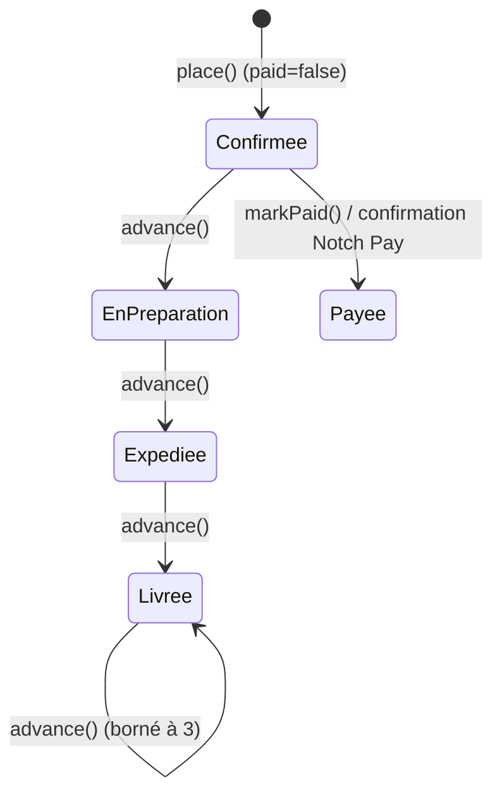
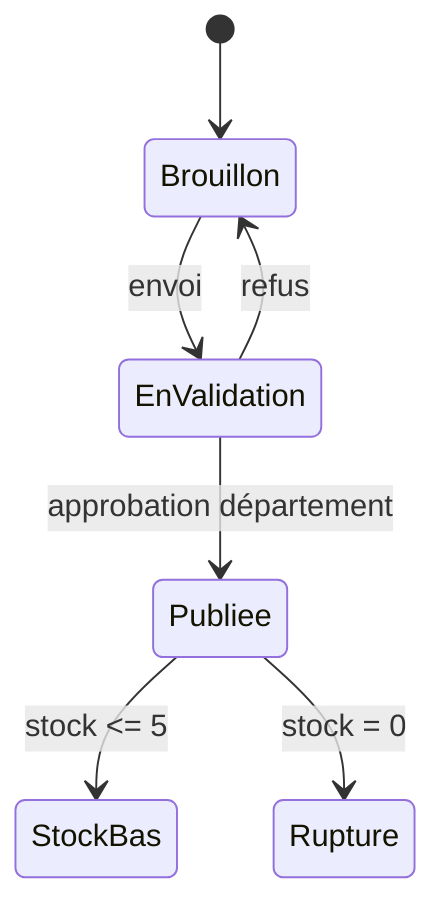
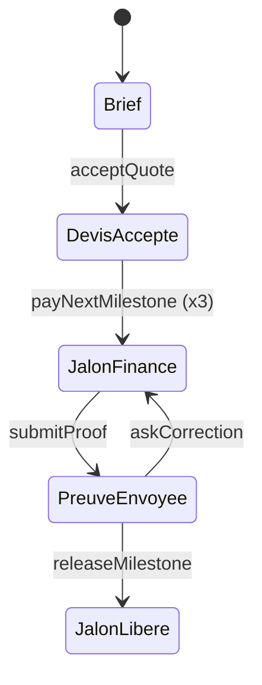

# 05 — Logique métier et données

## Source de vérité par entité (VÉRIFIÉ par le code)
| Entité | Où vit la donnée aujourd'hui | Table serveur existante | Lue par l'application | Écrite par l'application |
|---|---|---|---|---|
| Utilisateur / profil | mémoire (`seedAccounts`, comptes inscrits) + Supabase Auth | `profiles` | non | oui (inscription, `upsert`) |
| Rôle | déduit du compte local (`Account.staff`/`role`) | `profiles.role` | non | non (créé par l'inscription) |
| Produits, services, projets, talents | constantes dans `store.dart`, `section_*_demo.dart` | `listings` (jamais utilisée) | non | non |
| Annonces vendeur, stock | `Listings` en mémoire (5 annonces d'origine) | `listings` | non | non |
| Panier | `cartProvider` (mémoire) | — | — | — |
| Commande | `ordersProvider` + 4 commandes codées (`_history`) | `orders`, `order_lines` | non | oui (insertion) |
| Paiement | Notch Pay + `orders.paid` | `orders` | via fonction `pay` | via fonction `pay` |
| Favoris | `favoritesProvider` | `favorites` | non | non |
| Messages | `chatProvider` | (aucune) | non | non |
| Missions, jalons | `missionProvider` | `missions` | non | non |
| Hackathons | `hackathons.dart` | `hackathon_teams` | non | non |
| Borne (QR) | `kioskSessionProvider` | `kiosk_sessions` | non | non |
| Journal d'audit | `auditProvider` | `audit_log` | non | oui (insertion) |
| Notifications | écrans statiques | (aucune) | — | — |
| Avis | écrans seulement | (aucune) | — | — |

Conclusion : **la base ne sert aujourd'hui qu'à enregistrer** (connexion, commandes, journal) ; aucun écran n'est alimenté par elle (AN-007).

## Machines à états reconstituées

### Commande (`store.dart`)

- Transitions légales dans le code : 0→1→2→3 par `advance`, bornées par `clamp(0,3)`. **Aucun contrôle** : `advance` ne vérifie ni le rôle ni le paiement (une commande non payée peut être « livrée »). Aucune transition d'annulation n'est codée (les commandes annulées sont des données d'origine).
- Côté serveur : `status` est libre à l'insertion (AN-003) ; la fonction `pay` met `status = 1` à la confirmation du paiement.
- Règle indéterminée : qui fait avancer les statuts (vendeur ? admin ?) → question métier Q-07.

### Annonce (`seller.dart`, `review.dart`)

- Le libellé est calculé (`Listing.label`). Côté serveur la colonne `status` a quatre valeurs (`pending/approved/rejected/removed`) qui ne correspondent pas aux états de l'application (AN-004).

### Mission (`missions.dart`)

- Répartition fixe 30/40/30, commission 10 %, part étudiant 70 % (`Mission.shares`, `fee`, `studentEarned`) : règles **codées en dur** (Q-03).

### Borne (QR) : créé → utilisé (usage unique) | expiré après 300 s (`QrSession`) ; tout en mémoire.

## Montants et règles chiffrées (VÉRIFIÉ)
- Total panier = Σ prix × quantité ; livraison à domicile = 5 000 FCFA, retrait gratuit (`store.dart:91-97`). Frais de service et taxes : absents. Devise : FCFA, arrondi à l'entier.
- Répartition « fonds d'innovation 20 % » affichée sur la facture, calculée à l'affichage seulement (`docs.dart`).
- Validation des prix côté serveur : **absente** (AN-003). Prévention de stock négatif : absente côté serveur (AN-008) ; côté application `setStock` borne à 0 uniquement.

## Divergences relevées
1. Statuts d'annonce : application (4 libellés dérivés) ≠ serveur (`pending/approved/rejected/removed`).
2. Numérotation des commandes : compteur local (`_n = 143`) ≠ unicité serveur (AN-009).
3. Deux représentations d'une même commande : `ordersProvider` (client) et `sellerOrdersProvider` (vendeur) non reliées.
4. Rôles : 10 valeurs dans `app_role` (serveur) et 4 « rôles d'inscription » + « staff » côté application, regroupés par `roleKey()`.
5. Statuts de commande : l'application utilise 0–3 ; `cancelled` est un indicateur à part non écrit par un flux.

## Tableaux de bord (VÉRIFIÉ par le code)
Indicateurs calculés à partir de listes locales initialisées avec des constantes (`_history`, `seedAccounts`, annonces d'origine) ; aucune formule ne lit la base. Les chiffres changent uniquement avec les actions de la session courante. Période, filtres et fréquence de mise à jour : non applicables.
